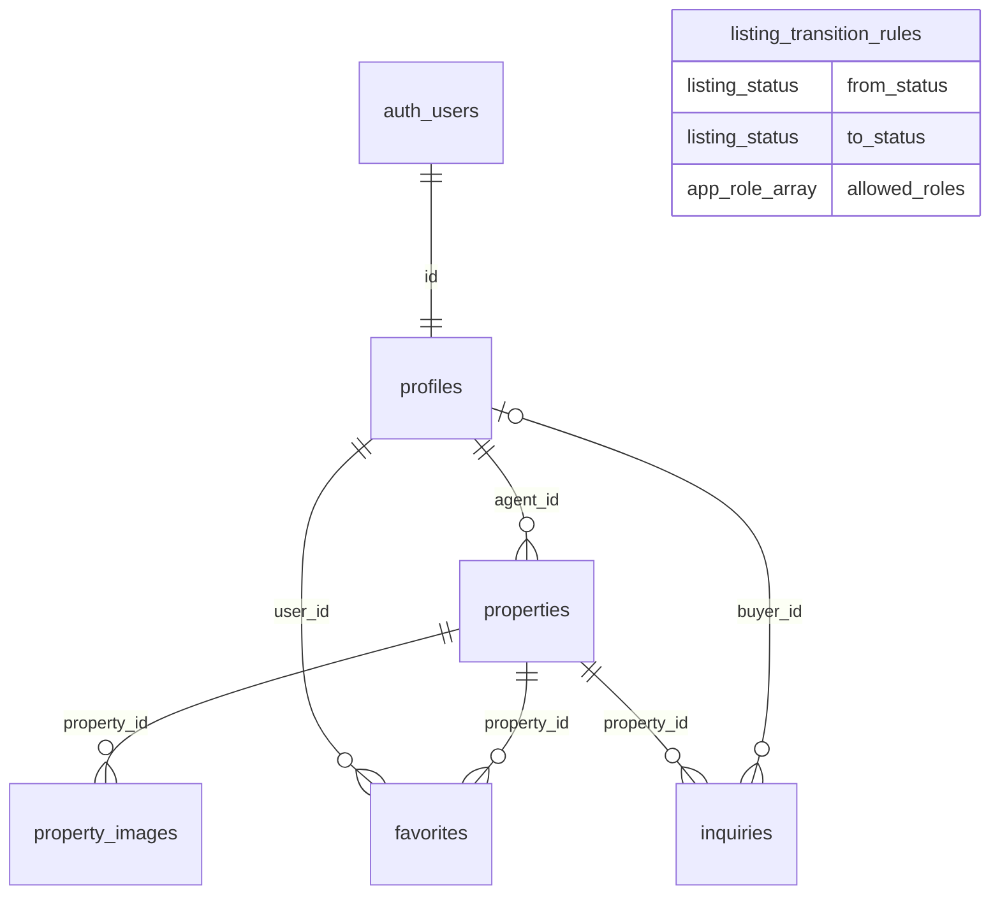

# Backend

The listing pages, the inquiry form, and the three dashboards read and write through this layer. Guests, buyers, agents, and admins share one Postgres database. Row Level Security decides what each session can see. The TypeScript in `src/lib/data` and `src/lib/actions` maps those rows to the types in `src/lib/domain/types.ts`.

## Sold listings stay on the site

A guest can read a listing when its status is `published` or `sold`. A sold house remains part of the public record, and the property page still opens by slug. The browse query `listProperties` asks for `published` only, so the catalog stays current. Inquiries are accepted only while the status is `published`. Draft, pending, and archived rows are visible to the listing's agent and to an admin.

## Roles and permissions

`app_role` is `buyer`, `agent`, or `admin`. Signup may request `buyer` or `agent`. Any other value, including `admin`, is stored as `buyer`. An admin appoints further admins later. The last admin cannot be removed.

| Action | Guest | Buyer | Agent | Admin |
| --- | --- | --- | --- | --- |
| Read published and sold listings, and their photos | yes | yes | yes | yes |
| Read draft, pending, and archived listings | no | no | own rows | all rows |
| Insert a listing | no | no | own row, status `draft` | yes, status `draft` |
| Update listing copy the session can already see | no | no | own rows | all rows |
| Change `agent_id` | no | no | no | yes |
| Set `featured` | no | no | no | yes |
| Move `pending` to `published` | no | no | no | yes |
| Move `draft` to `sold` | no | no | no | no |
| Read a profile | no | own row | own row, plus agents who have a published or sold listing | all rows |
| Update own profile, except `role` | no | yes | yes | yes |
| Change `role` | no | no | no | yes, except the last admin |
| Read favorites | no | own rows | own rows | all rows |
| Insert a favorite on a published or sold listing | no | own row | own row | own row |
| Insert an inquiry on a published listing | yes, `buyer_id` null | `buyer_id` null or self | same as buyer | same as buyer |
| Read inquiries | no | own rows | rows for own listings | all rows |
| Update an inquiry | no | no | status only, on own listings | any column |
| Upload, replace, or delete a file in `property-images` | no | no | first folder equals own user id | first folder equals own user id |

Ownership of a listing is the `agent_id` check in RLS. The status machine is a separate table, `listing_transition_rules`, and it matches `LISTING_TRANSITIONS` in the domain module. A no-op status write is allowed. Entering `published` sets `published_at` when it is still null.

`saveListing` writes the descriptive fields. It does not send `status`, `featured`, or `agent_id`. A new row starts as `draft`. An existing row keeps its status, so a typo on a live listing does not require a trip back through moderation. Status changes go through `transitionListing`.

## Authentication

Supabase Auth issues the session. `@supabase/ssr` stores it in httpOnly cookies. `src/proxy.ts` runs `getUser` on each matched request, writes any refreshed cookies onto the response, and sends an anonymous request for `/dashboard/*` to `/login?next=...`. The matcher skips `_next/static`, `_next/image`, and image files.

The proxy check is a gate, not the authorization. Server code calls `getUser` again, then reads `profiles` through RLS. `requireRole` sends a guest to `/login?next=` and sends a signed-in user of the wrong role to that role's dashboard.

`src/lib/auth/paths.ts` maps the role.

| Role | Path |
| --- | --- |
| buyer | `/dashboard/buyer` |
| agent | `/dashboard/agent` |
| admin | `/dashboard/admin` |

Local auth has email confirmation off. `site_url` in `supabase/config.toml` is `http://localhost:3000`.

## Schema



`auth_users` is `auth.users`. Deleting the auth user deletes the profile. Deleting a profile is restricted while that person still has listings. Images and favorites follow the property. An inquiry blocks deletion of its property until the inquiry is removed. Deleting a buyer sets `inquiries.buyer_id` to null and keeps the message for the agent.

| Table | What it stores |
| --- | --- |
| `profiles` | `role`, `full_name`, `phone`, `avatar_url`, `agency`, `license_no`, `bio`, timestamps. Primary key matches `auth.users.id`. |
| `listing_transition_rules` | One row per allowed move. `from_status`, `to_status`, `allowed_roles`. |
| `properties` | Slug, agent, copy, `listing_type`, `property_type`, `status`, `price_php`, beds, baths, areas, parking, neighborhood, city, province, address, coordinates, `amenities`, `year_built`, `featured`, `published_at`. `search` is a generated `tsvector` over title, neighborhood, city, province, and description, with a GIN index. Other indexes cover `(status, city)`, `price_php`, and `published_at`. |
| `property_images` | `url`, `storage_path` (null for a remote seed URL), `alt`, `position`. Unique on `(property_id, position)`. The cover is the lowest position. |
| `favorites` | Primary key `(user_id, property_id)`, plus `created_at`. |
| `inquiries` | Property, optional buyer, name, email, phone, message, optional viewing date, `status` (`new`, `contacted`, `closed`). Checks cover lengths and a simple email shape. |

Enums match the TypeScript unions. `listing_type` is `sale` or `rent`. `property_type` is `house`, `condominium`, `townhouse`, `villa`, `penthouse`, or `lot`. `listing_status` is `draft`, `pending`, `published`, `sold`, or `archived`. `price_php` is a positive bigint. Rent is the monthly amount in the same column.

The storage bucket `property-images` is public to read, limited to 8 MB, and limited to JPEG, PNG, WebP, and AVIF. The policies are in the same migration as the tables.

## Data access

`src/lib/data/*.ts` imports `server-only` and the cookie-bound server client. Mappers at that boundary turn rows into `PropertySummary`, `PropertyDetail`, and `Inquiry`. Validation schemas live in `src/lib/validation` and do not import server code, so a form can use the same schema for inline errors. Server actions in `src/lib/actions` parse input with those schemas and return `ActionResult<T>`.

`listProperties` filters on the server. Page size is 12 (`LISTING_PAGE_SIZE`). `q` uses `websearch_to_tsquery` with the `simple` configuration. The other filters are listing type, property type, city, price range, minimum bedrooms, sort, and page. `parseListingFilters` accepts `URLSearchParams` or a plain record and drops values it does not recognize. `type=sale` sets `listingType`. `type=house` sets `propertyType`.

`getMarketStats` counts published listings and distinct cities. The median is `percentile_cont(0.5)` over published **sale** prices only, so a monthly rent does not sit in the same series as a house price.

This is the catalog query, shortened, and the summary object returned for the Siargao villa on the local API.

```ts
const { data, count } = await supabase
  .from("properties")
  .select("id, slug, title, listing_type, price_php, property_images(id, url, alt, position)", {
    count: "exact",
  })
  .eq("status", "published")
  .textSearch("search", "siargao", { type: "websearch", config: "simple" });
```

```json
{
  "id": "23f7d545-5a1a-43fd-bb83-92acb075b5c6",
  "slug": "siargao-cloud-nine-villa",
  "title": "Villa off Cloud 9, Siargao",
  "listingType": "sale",
  "propertyType": "villa",
  "status": "published",
  "pricePhp": 68000000,
  "bedrooms": 4,
  "bathrooms": 4,
  "floorAreaSqm": 380,
  "lotAreaSqm": 700,
  "neighborhood": "Cloud 9",
  "city": "General Luna",
  "province": "Surigao del Norte",
  "coverImage": {
    "id": "d326b775-cd34-4cc4-a26a-f0a8b42be63c",
    "url": "https://images.unsplash.com/photo-1464376810568-596bdd5a1897?auto=format&fit=crop&w=2000&q=80",
    "alt": "Still ocean at dusk fading from soft green water to a blush-pink sky",
    "position": 0
  },
  "featured": true,
  "publishedAt": "2026-01-08T02:00:00+00:00"
}
```

`getMarketStats` calls `market_stats()`. The local result after seed is `listingCount` 19, `cityCount` 10, and `medianPricePhp` 68000000.

A failed inquiry returns the field message from the shared schema. A short message produces this `ActionResult`.

```json
{
  "ok": false,
  "fieldErrors": {
    "message": "Write at least 20 characters."
  }
}
```

A successful `submitInquiry` returns `{ "ok": true, "data": { "id": "<uuid>" } }`. The action inserts that id itself, because an anonymous session is allowed to insert and is not allowed to read the row back. `signIn` and `signUp` redirect on success. A bad password returns `{ "ok": false, "formError": "Email or password is incorrect." }`.

## Security

- RLS is enabled on every application table. Grants without a matching policy still deny the row.
- `current_app_role()` and `is_admin()` are `security definer` and `stable`, with `search_path` set to empty, and they are owned by `postgres`.
- `handle_new_user` will not write `admin` from signup metadata.
- `prevent_role_escalation` rejects a role change from anyone except an admin. The service role, used only by `scripts/seed.ts`, may appoint the first admin.
- `enforce_listing_transition` reads `listing_transition_rules`. The same trigger blocks a non-admin from setting `featured` or changing `agent_id`.
- `enforce_inquiry_throttle` takes a transaction advisory lock on the email and rejects the sixth inquiry from that email in an hour. It is `security definer`, so a sender cannot hide earlier rows with RLS.
- `restrict_inquiry_update` lets an agent change `status` and nothing else.
- Zod parses every action body. Supabase and Postgres errors are replaced with a short sentence. Raw SQL text is not returned.
- Storage policies require the role `agent` or `admin` and a first path segment equal to `auth.uid()`.
- `requireRole` and the proxy both guard `/dashboard/*`. The database check is the one that matters.

## Demo accounts

Every seeded account uses the password `Estate!2026`.

| Email | Role |
| --- | --- |
| `admin@4our.estate` | admin |
| `isabel.santos@4our.estate` | agent, Atelier Santos |
| `mateo.cruz@4our.estate` | agent, Northbound Estates |
| `ana.reyes@4our.estate` | agent, Ridge & Plain |
| `rafael.delacruz@4our.estate` | agent, Visayas House |
| `sofia.navarro@4our.estate` | agent, Isla Norte |
| `camille.uy@4our.estate` | buyer |
| `joaquin.tan@4our.estate` | buyer |
| `bea.lim@4our.estate` | buyer |

`npm run db:seed` is safe to run again. The second run leaves the same users, listings, images, inquiries, and favorites in place. Images come from `src/lib/photography/catalog.ts`. Before that file is on this branch, set `PHOTO_CATALOG_PATH` to the catalog module. Each listing gets 4 to 6 frames. Cover URLs are not reused. Beach houses prefer `view-sea`, BGC towers prefer `view-city`, and the El Nido lot prefers `land-lot`.

## Commands

```bash
npm run db:reset
npm run db:seed
npm run db:types
npm run verify:rls
```

`verify:rls` signs in as a guest, a buyer, two agents, and the admin, prints a pass or fail line per check, and exits non-zero if any check fails. It deletes the rows and the storage object it created.

## Functions the UI calls

Data functions throw a generic `Error` when the query fails. They do not return the database message.

```ts
getViewer(): Promise<Viewer>
requireRole(...roles: [Role, ...Role[]]): Promise<Member>

listProperties(filters: ListingFilters): Promise<Page<PropertySummary>>
getFeaturedProperties(limit?: number): Promise<PropertySummary[]>
getPropertyBySlug(slug: string): Promise<PropertyDetail | null>
getSimilarProperties(detail: PropertyDetail, limit?: number): Promise<PropertySummary[]>
listCities(): Promise<CityCount[]>
getMarketStats(): Promise<MarketStats>

listFavorites(): Promise<PropertySummary[]>
getFavoriteIds(): Promise<string[]>
listMyInquiries(): Promise<Inquiry[]>

listAgentListings(): Promise<PropertySummary[]>
listAgentInquiries(): Promise<Inquiry[]>
getEditableProperty(id: string): Promise<PropertyDetail | null>

listModerationQueue(): Promise<PropertySummary[]>
listUsers(): Promise<DirectoryUser[]>
getAdminStats(): Promise<AdminStats>
```

`CityCount`, `MarketStats`, `DirectoryUser`, and `AdminStats` are exported from `src/lib/data/types.ts`. `Member` is exported from `src/lib/data/viewer.ts`.

Actions use the `useActionState` signature `(prev, formData)`. Import `ActionResult` from `src/lib/actions/result.ts`.

```ts
signUp(prev, formData): Promise<ActionResult<null>>
signIn(prev, formData): Promise<ActionResult<null>>
signOut(prev, formData): Promise<ActionResult<null>>
submitInquiry(prev, formData): Promise<ActionResult<{ id: string }>>
toggleFavorite(prev, formData): Promise<ActionResult<{ favorited: boolean }>>
saveListing(prev, formData): Promise<ActionResult<{ id: string; slug: string }>>
uploadListingImage(prev, formData): Promise<ActionResult<PropertyImage>>
deleteListingImage(prev, formData): Promise<ActionResult<{ id: string }>>
setCoverImage(prev, formData): Promise<ActionResult<{ id: string }>>
transitionListing(prev, formData): Promise<ActionResult<{ id: string; status: ListingStatus; slug: string }>>
updateInquiryStatus(prev, formData): Promise<ActionResult<{ id: string; status: InquiryStatus }>>
updateProfile(prev, formData): Promise<ActionResult<{ id: string }>>
setUserRole(prev, formData): Promise<ActionResult<{ id: string; role: Role }>>
```

`signUp`, `signIn`, and `signOut` redirect when they succeed, so the form only receives the failure result. `signIn` and `signUp` read an optional `next` field and ignore values that are not a same-site path. `toggleFavorite` returns a form error for a guest instead of redirecting, so a save button can show "Sign in to save a listing."

Form field names match the schema keys. `amenities` may be repeated or sent as one comma-separated value. `uploadListingImage` also reads a `file` field. Phone values may be `+63 9XX XXX XXXX` or `09XXXXXXXXX`. The schema stores `+63 9XX XXX XXXX`.
